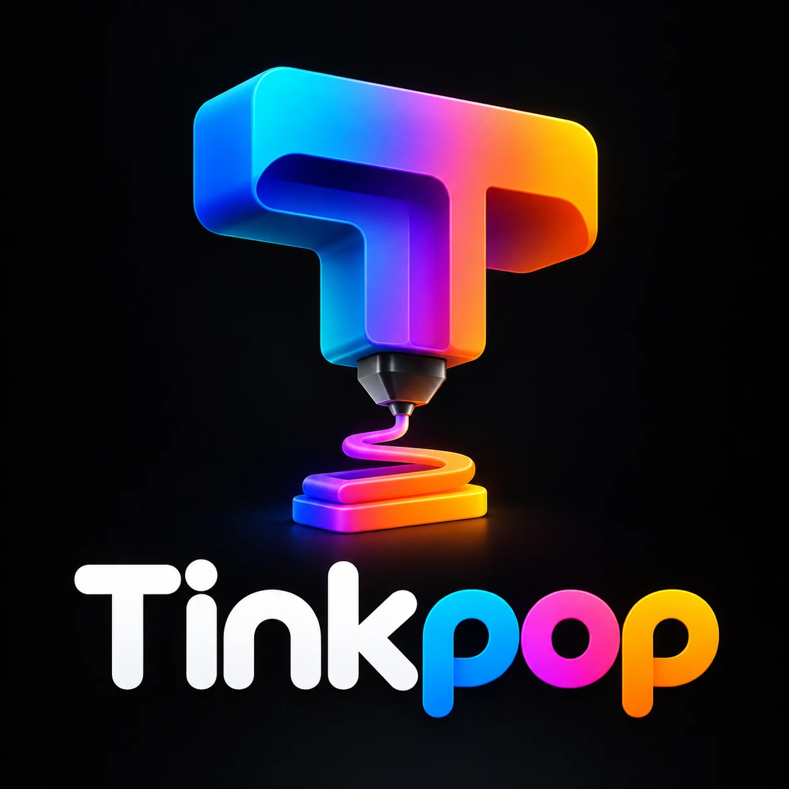

# Merk

## Logo-concept v1 (28-10-2026)

Aangeleverd door de eigenaar. De T is een 3D-printer: uit de onderkant komt een spuitmond die een filamentlijn op een plaatje legt. Woordmerk "Tink" in wit, "pop" in kleurverloop.

### Sterk
- Vertelt het verhaal zonder uitleg: de letter T print zelf iets.
- Kleurverloop cyaan → roze → oranje past bij "pop" en bij kleurrijk filament.
- Ronde letters: vriendelijk en speels.

### Nog te doen
- **Simpele versie voor klein formaat** (favicon 16–32 px, profielfoto in een cirkel): alleen de T met spuitmond, plat, zonder glans en schaduw.
- **Vectorbestand (SVG)** nodig voor site, stickers en prints; de huidige versie is een plaatje.
- **Lichte achtergrond**: "Tink" is wit en verdwijnt op wit; een donkere variant van het woordmerk maken.
- **Lijkt op Instagram-kleuren** (blauw-roze-oranje); op Instagram valt het daardoor minder op. Overwegen: één kleur dominant maken.
- Als het logo met AI gemaakt is: merkregistratie kan, maar auteursrecht op AI-beelden is onzeker. Een vectorversie die we zelf natekenen lost dat deels op.

## Logo-concept v2 (28-10-2026)
Zelfde ontwerp op witte achtergrond, woordmerk "Tinkpop" met zwarte rand. Lost het probleem van witte letters op wit op. Bestand nog niet in de repo (alleen in de chat gedeeld). Blijft open: platte versie voor klein formaat, SVG.
